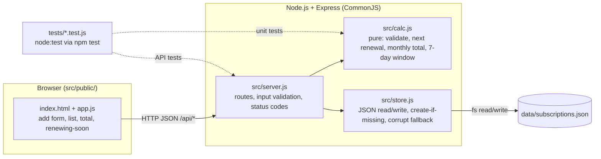

# Architecture

## 1. Overview
A single-user, local Express app serves a vanilla HTML/JS page that lets the user add, list, and delete subscriptions, and shows the monthly INR total and the subscriptions renewing within 7 days. Data is persisted in `data/subscriptions.json`; all date and money logic lives in pure functions in `src/calc.js`.
Covers requirements FR-1 to FR-12 and NFR-1 to NFR-5 from `docs/requirements.md` (story SUBT-3).

## 2. Component Diagram

## 3. Components & Responsibilities
| Component | Responsibility | Files |
|-----------|----------------|-------|
| Server routes | Express app. Serves `src/public/` as static files. Exposes the endpoints in section 6. Validates request body (FR-1, FR-2, FR-11), returns 404 for unknown ids (FR-12), and maps results to HTTP status codes. Whitelists fields so `notes` is never stored (FR-2). Listens on a local port only when run directly. | `src/server.js` |
| Calc (pure logic) | Validation rules for a subscription (FR-11). Next renewal date by roll-forward from the stored date (FR-8). Monthly total with yearly divided by 12 (FR-5). Renewing-soon filter for today through today+7 inclusive (FR-7). No I/O, no globals, takes "today" as a parameter so it is testable (NFR-5). | `src/calc.js` |
| Store | Reads and writes `data/subscriptions.json`. Creates the file (and `data/` folder) if missing. Returns an empty list if the file is missing or contains invalid JSON, without throwing (NFR-1). Lists, adds, and deletes by id (FR-1, FR-3, FR-4). The file path is a constant built from `__dirname`; no user input reaches it (NFR-2). | `src/store.js`, `data/subscriptions.json` (runtime, git-ignored) |
| Web UI | One page with the add form (FR-1), subscription list with name, cost, cycle, category, next renewal date (FR-3), delete button per row (FR-4), monthly total (FR-5), and renewing-soon section (FR-7). No edit control (FR-9). No login screen (FR-10). Amounts prefixed with ₹ (FR-6). Renders all server data with `textContent` (NFR-2). Plain HTML/CSS/JS, no build step (NFR-3). | `src/public/index.html`, `src/public/app.js`, `src/public/styles.css` |
| Tests | `node:test` and `node:assert`. Unit tests for `calc.js` (AC-5, AC-7, AC-8, AC-9, month-end and leap-year cases). Store tests for missing and corrupt file (AC-14). API tests for 400 and 404 responses (AC-12, AC-13) and for the notes field being dropped (AC-2). Run with `npm test`. | `tests/calc.test.js`, `tests/store.test.js`, `tests/api.test.js` |

## 4. Technology Choices
| Concern | Choice | Reason |
|---------|--------|--------|
| Runtime | Node.js 18+, CommonJS (`require`) | Project stack and `.claude/rules/node.md`. Node 18 provides global `fetch` and `crypto.randomUUID` for tests and ids. |
| HTTP server | Express | Project stack. Minimal routing and JSON body parsing. |
| Frontend | Vanilla HTML/CSS/JS in `src/public/` | Project stack. No build step (NFR-3). |
| Storage | JSON file in `data/` | Project stack. Single user, tens of items (NFR-4). No database (out of scope). |
| Ids | `crypto.randomUUID()` | Unique without a counter file. Built into Node 18+. |
| Dates | ISO `YYYY-MM-DD` strings, parsed into local calendar dates | Matches the "ISO date" input rule. Avoids timezone shifts for "today" comparisons (requirements assumption). |
| Tests | `node:test`, `node:assert` | Project stack. No extra framework. |

## 5. Data Model
Stored in `data/subscriptions.json` as a JSON array of objects (file shape: `{ "subscriptions": [ ... ] }`).

| Field | Type | Required | Validation / rule |
|-------|------|----------|-------------------|
| `id` | string (UUID) | yes | Generated by server on create. Unique. Never accepted from the client. |
| `name` | string | yes | Trimmed, non-empty (FR-11). |
| `cost` | number | yes | Greater than 0 (FR-11). Stored and displayed in INR only (FR-6). |
| `cycle` | string | yes | Exactly `monthly` or `yearly` (FR-11). |
| `renewalDate` | string (`YYYY-MM-DD`) | yes | Valid ISO calendar date (FR-11). Stored as entered; may be in the past (roll-forward applies, FR-8). |
| `category` | string | no | Free text. Empty or missing means not set (FR-1). |

Not stored: `notes` or any other extra field (FR-2). Derived at read time, not stored: `nextRenewalDate` (FR-8).

## 6. API Design
| Method | Path | Request | Response | Errors |
|--------|------|---------|----------|--------|
| GET | `/api/subscriptions` | none | 200 `{ "subscriptions": [ { id, name, cost, cycle, category, renewalDate, nextRenewalDate } ] }` | 500 `{ "error" }` only if the store fails unexpectedly |
| POST | `/api/subscriptions` | JSON `{ name, cost, cycle, renewalDate, category? }`. Any other field (e.g. `notes`) is ignored. | 201 `{ subscription }` with the stored item and `nextRenewalDate` | 400 `{ "error" }` for empty name, cost <= 0 or non-number, cycle not monthly/yearly, invalid ISO date, or malformed JSON |
| DELETE | `/api/subscriptions/:id` | path `id` | 200 `{ "ok": true }` | 404 `{ "error" }` if id unknown |
| GET | `/api/summary` | none | 200 `{ "monthlyTotal": number, "renewingSoon": [ subscription items ] }` | 500 `{ "error" }` only on unexpected store failure |

No edit endpoint exists (FR-9). No auth endpoints exist (FR-10).

## 7. Data Flow
1. Page load: the browser requests `GET /api/summary` and `GET /api/subscriptions`. The server reads the file through `store.js`, computes `nextRenewalDate` for each item with `calc.js`, and returns JSON. The UI renders the list, total, and renewing-soon section using `textContent`.
2. Add subscription (FR-1, AC-1): the user submits the form. The browser POSTs JSON to `/api/subscriptions`. `server.js` calls `calc.validateSubscription`. On failure it returns 400 with `error`. On success it builds a record from whitelisted fields (no `notes`, FR-2), assigns a UUID, and calls `store.add`. `store.js` writes the file. The server returns 201. The UI refreshes list and summary.
3. List and total (FR-3, FR-5, FR-6): `GET /api/subscriptions` returns each item with `nextRenewalDate = calc.nextRenewalDate(renewalDate, cycle, today)`. `GET /api/summary` computes `calc.monthlyTotal(items)` where monthly adds `cost` and yearly adds `cost / 12`. The UI prefixes amounts with ₹.
4. Upcoming renewals (FR-7, AC-7): `calc.renewingWithin(items, today, 7)` keeps items whose `nextRenewalDate` is from today through today+7 inclusive. `GET /api/summary` returns this list. The UI shows it in its own section.
5. Roll-forward (FR-8, AC-8, AC-9): if `renewalDate` is before today, `calc.nextRenewalDate` adds the cycle (1 month or 1 year) to the stored date until the result is today or later. The stored value is not rewritten.
6. Delete (FR-4, FR-12, AC-4, AC-13): `DELETE /api/subscriptions/:id` calls `store.remove(id)`. If the id is not found, the server returns 404. Otherwise it returns 200. The UI refreshes.
7. Startup and corrupt data (NFR-1, AC-14): on first read, `store.js` creates `data/` and `subscriptions.json` with an empty list if missing. If the file is not valid JSON, `store.js` returns an empty list and does not throw. The server never exits because of file state.

## 8. Risks & Open Questions
- Corrupt file overwrite: if `subscriptions.json` is corrupt and the user adds an item, the next write replaces the corrupt content. Proposed: copy the corrupt file to `data/subscriptions.corrupt-<timestamp>.json` before writing. Needs confirmation.
- Month-end and leap-year roll-forward: a stored date of 31 Jan rolled monthly, and 29 Feb rolled yearly, need a rule. Proposed: always add from the stored anchor date and clamp to the last day of the target month (31 Jan + 1 month = 28/29 Feb; 29 Feb + 1 year = 28 Feb). Requirements say "the standard date library rule", which is not a date library in this stack. Needs confirmation.
- "Today" uses the server's local calendar day (requirements assumption). The UI shows server-computed dates, so browser timezone does not change results.
- Concurrent writes: a single Node process with serialized writes is assumed. Writes go through one `store.js` queue. Atomic write (temp file then rename) is recommended to avoid a half-written file on crash. Not required by the story.
- Cost precision: cost is stored as a number. Yearly/12 can give fractions (e.g. ₹1000/12). Display rounds to 2 decimals. Totals are not rounded before summing. Needs confirmation.
- Empty category: stored as absent, not as an empty string, so the list shows no category label.
- Delete response: 200 `{ "ok": true }` is chosen to match AC-4 wording "API returns success". Alternative 204 is equally valid.
- `data/` is git-ignored (commit `a1a188d`), so the sample or test data must not be committed.
