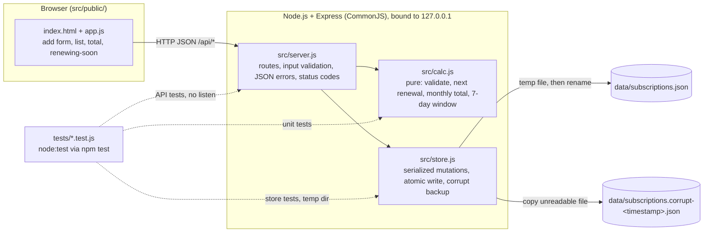

# Architecture

## 1. Overview
A single-user, local Express app serves a vanilla HTML/JS page that lets the user add, list, and delete subscriptions, and shows the monthly INR total and the subscriptions renewing within 7 days. Data is persisted in `data/subscriptions.json`; all date and money logic lives in pure functions in `src/calc.js`.
Covers requirements FR-1 to FR-12 and NFR-1 to NFR-5 from `docs/requirements.md` (story SUBT-3). Revised after design review (`docs/design-review.md`).

## 2. Component Diagram

## 3. Components & Responsibilities
| Component | Responsibility | Files |
|-----------|----------------|-------|
| Server routes | Express app, exported without listening. Listens on `127.0.0.1` only when run directly (DR-04). Serves `src/public/` as static files. Exposes the endpoints in section 6. Validates the request body, including types (FR-1, FR-2, FR-11, DR-06). Whitelists fields so `notes` is never stored (FR-2). Returns 404 for unknown ids (FR-12). A JSON error middleware returns `{ "error" }` for parse errors and unexpected failures, with no stack trace (DR-07). Body limit `10kb`. | `src/server.js` |
| Calc (pure logic) | Validation rules for a subscription, including strict `YYYY-MM-DD` with a calendar round-trip check and local date construction from components (FR-11, DR-05). Next renewal date: anchor on the stored date, smallest n so that the result is on or after today, computed arithmetically, day clamped to the last day of the target month (FR-8, DR-08). Monthly total with yearly divided by 12, unrounded (FR-5, DR-09). Renewing-soon filter for today through today+7 inclusive (FR-7). No I/O, no globals, takes "today" as a parameter (NFR-5). | `src/calc.js` |
| Store | Reads and writes the subscriptions file. The file path is injected by a factory; default is `data/subscriptions.json`, built from `__dirname` (NFR-2, DR-10). All mutations (add, delete) run through one promise queue so read-modify-write cannot interleave (DR-03). Writes go to a temp file in `data/`, then `rename` over the target (DR-02). Creates `data/` and the file if missing (NFR-1). If the file is unparseable or does not match `{ "subscriptions": [] }`, it copies the file to `data/subscriptions.corrupt-<timestamp>.json` before the next write, and reads return an empty list without throwing (NFR-1, DR-01, DR-12). Lists, adds, and deletes by id (FR-1, FR-3, FR-4). | `src/store.js`, `data/subscriptions.json` (runtime, git-ignored) |
| Web UI | One page with the add form (FR-1), list with name, cost, cycle, category, next renewal date (FR-3), delete button per row (FR-4), monthly total (FR-5), and renewing-soon section (FR-7). No edit control (FR-9). No login screen (FR-10). Amounts prefixed with ₹ and shown to 2 decimals (FR-6, DR-09). Renders all server data with `textContent` (NFR-2). Plain HTML/CSS/JS, no build step (NFR-3). | `src/public/index.html`, `src/public/app.js`, `src/public/styles.css` |
| Tests | `node:test` and `node:assert`. Unit tests for `calc.js` (AC-5, AC-7, AC-8, AC-9, month-end and leap-year cases). Store tests for missing, corrupt, and wrong-shape files, using a temp directory (AC-14, DR-10). API tests on the exported app: POST 201 (AC-1), DELETE 200 (AC-4), 400 cases (AC-12), 404 for unknown id (AC-13), notes dropped (AC-2), and PUT/PATCH on an item path returns 404 (AC-10, DR-11). Manual smoke check in verification for AC-3, AC-6, AC-11 (DR-11). Run with `npm test`. | `tests/calc.test.js`, `tests/store.test.js`, `tests/api.test.js` |

## 4. Technology Choices
| Concern | Choice | Reason |
|---------|--------|--------|
| Runtime | Node.js 18+, CommonJS (`require`) | Project stack and `.claude/rules/node.md`. Node 18 provides `crypto.randomUUID` and `fs.promises`. |
| HTTP server | Express | Project stack. Minimal routing and JSON body parsing. Bound to `127.0.0.1` because there is no auth (DR-04). |
| Frontend | Vanilla HTML/CSS/JS in `src/public/` | Project stack. No build step (NFR-3). |
| Storage | JSON file in `data/` | Project stack. Single user, tens of items (NFR-4). No database (out of scope). Atomic temp-and-rename write (DR-02). |
| Ids | `crypto.randomUUID()` | Unique without a counter file. Built into Node 18+. |
| Dates | Strict `YYYY-MM-DD` strings, built into local calendar dates from year, month, and day | Avoids `Date` string parsing, which is UTC for date-only strings and rolls over invalid days (DR-05). Keeps "today" comparisons on the server's local day. |
| Tests | `node:test`, `node:assert` | Project stack. No extra framework. |

## 5. Data Model
Stored in `data/subscriptions.json` with the shape `{ "subscriptions": [ ... ] }`. Any other shape is treated as corrupt (DR-12).

| Field | Type | Required | Validation / rule |
|-------|------|----------|-------------------|
| `id` | string (UUID) | yes | Generated by server on create. Unique. Never accepted from the client. |
| `name` | string | yes | Must be a string. Trimmed. Non-empty, at most 100 characters (FR-11, DR-06, DR-13). |
| `cost` | number | yes | Must be a finite JSON number, not a string. Greater than 0 (FR-11, DR-06). Stored and displayed in INR only (FR-6). Full precision stored. |
| `cycle` | string | yes | Exactly `monthly` or `yearly` (FR-11). |
| `renewalDate` | string (`YYYY-MM-DD`) | yes | Must match `^\d{4}-\d{2}-\d{2}$` and be a real calendar date (no 2026-02-30) (FR-11, DR-05). Stored as entered; may be in the past (roll-forward applies, FR-8). |
| `category` | string | no | Must be a string if present. Trimmed. Empty after trim means not set. At most 50 characters (FR-1, DR-13). Stored absent, not as an empty string. |

Not stored: `notes` or any other extra field (FR-2). Derived at read time, not stored: `nextRenewalDate` (FR-8).

## 6. API Design
| Method | Path | Request | Response | Errors |
|--------|------|---------|----------|--------|
| GET | `/api/subscriptions` | none | 200 `{ "subscriptions": [ { id, name, cost, cycle, category, renewalDate, nextRenewalDate } ] }` | 500 `{ "error" }` only if the store fails unexpectedly |
| POST | `/api/subscriptions` | JSON `{ name, cost, cycle, renewalDate, category? }`, body limit 10kb. Any other field (e.g. `notes`) is ignored. | 201 `{ "subscription": {...} }` with the stored item and `nextRenewalDate` | 400 `{ "error" }` for wrong types, empty or over-long name, cost <= 0 or non-finite, cycle not monthly/yearly, invalid ISO date, over-long category, or malformed JSON. 500 `{ "error" }` if the write fails; the item is not reported as created (DR-14). |
| DELETE | `/api/subscriptions/:id` | path `id` (opaque string, never used as a path) | 200 `{ "ok": true }` | 404 `{ "error" }` if id unknown. 500 `{ "error" }` if the write fails. |
| GET | `/api/summary` | none | 200 `{ "monthlyTotal": number, "renewingSoon": [ subscription items ] }` | 500 `{ "error" }` only on unexpected store failure |

No edit endpoint exists (FR-9). PUT and PATCH on an item path return 404 (AC-10). No auth endpoints exist (FR-10).

## 7. Data Flow
1. Page load: the browser requests `GET /api/summary` and `GET /api/subscriptions`. The server reads the file through `store.js`, computes `nextRenewalDate` for each item with `calc.js`, and returns JSON. The UI renders with `textContent`.
2. Add subscription (FR-1, AC-1): the browser POSTs JSON. `server.js` checks types and calls `calc.validateSubscription`. On failure it returns 400 with `error`. On success it builds a record from whitelisted fields (no `notes`, FR-2), trims name and category, assigns a UUID, and calls `store.add`. `store.add` runs in the mutation queue: it reads the file, and if the file is corrupt it backs it up first (DR-01). It then writes the temp file and renames it (DR-02). If the write fails, the server returns 500. On success it returns 201. The UI refreshes list and summary.
3. List and total (FR-3, FR-5, FR-6): `GET /api/subscriptions` returns each item with `nextRenewalDate = calc.nextRenewalDate(renewalDate, cycle, today)`. `GET /api/summary` computes `calc.monthlyTotal(items)` where monthly adds `cost` and yearly adds `cost / 12`, unrounded. The UI rounds to 2 decimals and prefixes ₹.
4. Upcoming renewals (FR-7, AC-7): `calc.renewingWithin(items, today, 7)` keeps items whose `nextRenewalDate` is from today through today+7 inclusive. `GET /api/summary` returns this list. The UI shows it in its own section.
5. Roll-forward (FR-8, AC-8, AC-9): if `renewalDate` is before today, `calc.nextRenewalDate` finds the smallest n >= 0 such that the stored anchor plus n months (or n years) is on or after today. The day is clamped to the last day of the target month, so 31 Jan + 1 month = 28/29 Feb and 29 Feb + 1 year = 28 Feb. Each result is computed from the anchor, not from the previous result (DR-08). The stored value is not rewritten.
6. Delete (FR-4, FR-12, AC-4, AC-13): `DELETE /api/subscriptions/:id` calls `store.remove(id)` in the mutation queue. If the id is not found, the server returns 404. If the write fails, 500. Otherwise 200. The UI refreshes.
7. Startup and corrupt data (NFR-1, AC-14): on first read, `store.js` creates `data/` and `subscriptions.json` with an empty list if missing. If the file is not valid JSON or has the wrong shape, reads return an empty list and do not throw. The next mutation copies the bad file to `data/subscriptions.corrupt-<timestamp>.json` before writing. The server never exits because of file state.

## 8. Risks & Open Questions
- Name and category length limits (100 and 50 characters) are a reviewer proposal, not a requirement. Confirm with the user (DR-13).
- Manual smoke check is used for AC-3, AC-6, and AC-11 (UI). Confirm whether a browser test is wanted (DR-11).
- Single process assumed. Two server processes on the same `data/` folder are not supported; the queue is in-process only.
- "Today" uses the server's local calendar day (requirements assumption). The UI shows server-computed dates, so browser timezone does not change results.
- Corrupt backup files accumulate in `data/`. No cleanup is in scope.
- `data/` is git-ignored (commit `a1a188d`), so sample or test data must not be committed.
